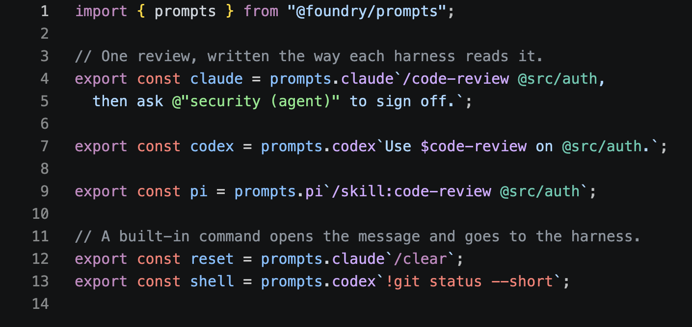

**`prompts` reads a prompt the way a coding harness reads it.** It comes
with Marbles: import it from `@foundry.sh/marbles`.

Each harness has its own notation. Claude Code invokes a skill as `/name`,
Codex mentions one as `$name`, and Pi loads one as `/skill:name`. All three
mention a file as `@path`; Claude Code mentions an agent as
`@"name (agent)"`. `prompts` knows these notations. It lists what a prompt
references, checks each reference against the skills, agents, and files you
tell it about, and writes a reference in the notation each harness expects.

```typescript
import { prompts, ref } from "@foundry.sh/marbles";

prompts.add({ skill: ["code-review"], agent: ["reviewer"] });

const reviewer = ref.agent("reviewer");
const review = prompts.claude`/code-review @src/auth, then ask ${reviewer}.`;

review.text;
// '/code-review @src/auth, then ask @"reviewer (agent)".'
review.references;
// the skill, the file, and the agent, each with its position
review.diagnostics;
// empty here; without "reviewer" in the list, 'Unknown agent "reviewer".'
```

`prompts.codex` and `prompts.pi` work the same way. A reference interpolated
with `ref` is written in the notation of the tag it lands in, so the same
skill reads as `/code-review`, `$code-review`, or `/skill:code-review`.

`prompts.add` says what exists: a list of names or a function per kind
(`skill`, `agent`, `file`). A kind you have not described is never
questioned. Diagnostics are read against what exists each time you ask, so
a skill added after the prompt was written still resolves. With
`prompts.strict = true`, a tag throws a `PromptError` instead of returning
a prompt with errors.

An agent takes its prompt as a string, so pass `review.text` or
`String(review)` as `agent({ prompt })`. `@foundry.sh/marbles` exports
`prompts`, `ref`, `PromptError`, and the `Prompt` class.

These exports are not in `0.0.3`. They ship in the next release.

## In the editor

[Editor support](/prompts/editor) covers a VS Code extension that highlights
these references as you write them, in TypeScript and in skill, agent, and
rule files. [Linting](/prompts/lint) covers the ESLint and Oxlint rules that
check them.


