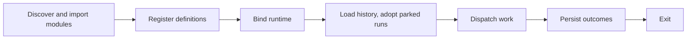
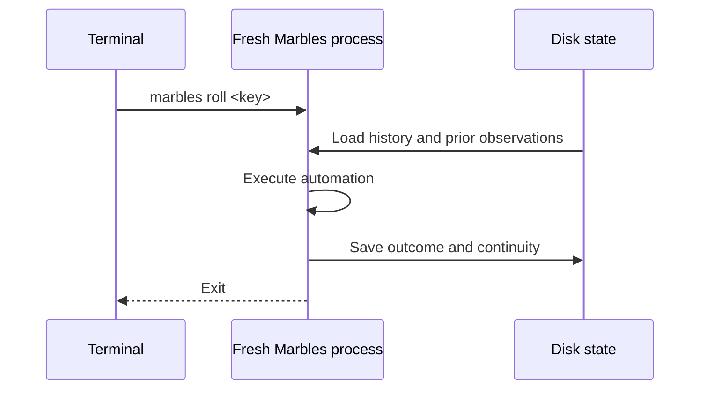

Read [Durability](/marbles/foundation/durability) for the guarantees around
finished results, replay, retry, and recovery. This page follows how the
CLI hosts the [Workflows runtime](https://github.com/Francois-Esquire/foundry/blob/main/packages/workflows/README.md)
and connects the [Foundry primitives](/marbles/foundation/primitives) to a run.

Each command starts a fresh process. For execution commands, importing modules from `.foundry/marbles`
registers definitions. Then the CLI binds the runtime step bodies receive:
providers, workspaces, sandboxes, artifacts, sessions, and logging. Finally it
dispatches work.

“Register, then bind” means describing work before choosing its runtime.
It lets one module support inspection, real execution, and dry substitutions.
Calling a word does not execute a step body. Ordinary code at module scope
still runs during import, even for inspection commands.

| Mode | Lifetime |
| --- | --- |
| `marbles roll <name-or-key>` | Dispatch one definition, schedule, or monitor and exit. Cannot answer a question. |
| `marbles` | Keep the dashboard active for schedules, monitors, launches, and answers. |
| `marbles run` with piped input or output | Keep schedules and monitors running with plain output. Cannot answer a question. |

Keep Marbles running to execute schedules and monitors on their cadence.
`roll` runs one tick immediately and exits; it does not keep a clock running.
Both modes share the same workspace state.

State belongs to the workspace root. A session continued by
reference reuses its conversation after the previous process exits. A file
monitor compares today's digests with the last handled observation. A
declared artifact gains a version per run.

## What a restart keeps

A run parked on a question or a pause is written to disk as it parks, with
the sessions and sandboxes each step opened, the input each step was locked
with, and the run's own session. A quit, a crash, or a kill does not lose it.
The next dashboard that starts with the same state root and still registers
the step adopts the run, keeps its question open, and on the answer replays
the step body against the recorded sessions.

A run that was mid-body when the process stopped is not resumed. The last
saved snapshot keeps the results it contains, but newer progress may not
have reached disk. Nothing picks the run up; `status` shows saved running
records as orphaned. This is the boundary today: parked work can be
adopted, running work cannot.

See [state](/marbles/reference/state) for the layout and the adoption rules,
and [safety and limits](/marbles/reference/safety) for dry-run boundaries.

## Replay and retry

Replay continues an unfinished step after a waiting point. Retry starts a
fresh attempt after failure under the step's configured policy. Neither is
a new scheduled run. The [durability guide](/marbles/foundation/durability#replay-is-different-from-retry)
lists which operations reuse recorded work and which can execute again.

The [state reference](/marbles/reference/state) separates run snapshots,
session transcripts, trigger observations, and artifact storage. An
[embedding host](/marbles/reference/engine) chooses its stores explicitly;
the CLI provides their local persistent defaults.
