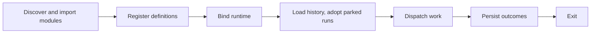
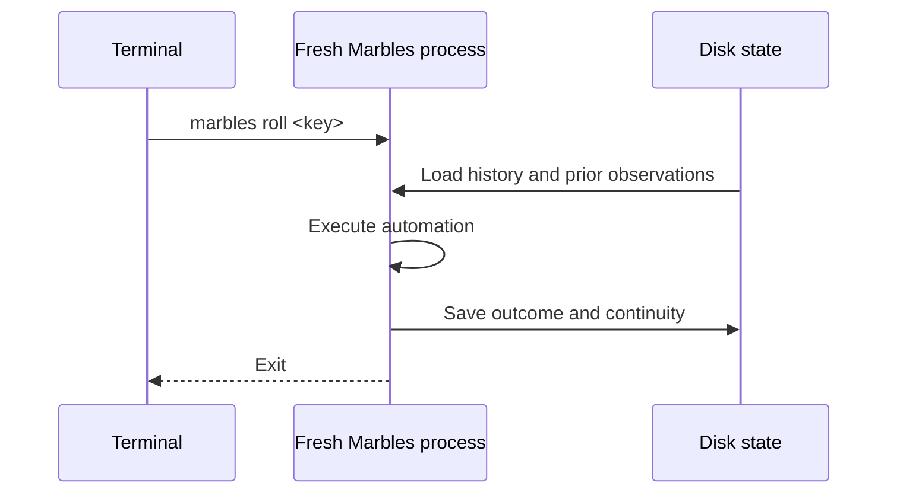

Each command starts a fresh process. For execution commands, importing modules from `.foundry/marbles`
registers definitions. Then the CLI binds the runtime step bodies receive:
providers, workspaces, sandboxes, artifacts, sessions, and logging. Finally it
dispatches work.

“Register, then bind” means describing work before choosing its runtime.
It lets one module support inspection, real execution, and dry substitutions.
Calling a word does not execute a step body. Ordinary code at module scope
still runs during import, even for inspection commands.

| Mode | Lifetime |
| --- | --- |
| `marbles roll <name-or-key>` | Dispatch one definition, schedule, or monitor and exit. Cannot answer a question. |
| `marbles` | Keep the dashboard active for schedules, monitors, launches, and answers. |
| `marbles run` with piped input or output | Keep schedules and monitors running with plain output. Cannot answer a question. |

Keep Marbles running to execute schedules and monitors on their cadence.
`roll` runs one tick immediately and exits; it does not keep a clock running.
Both modes share the same workspace state.

State belongs to the workspace root. A session continued by
reference reuses its conversation after the previous process exits. A file
monitor compares today's digests with the last handled observation. A
declared artifact gains a version per run.

## What a restart keeps

A run parked on a question or a pause is written to disk as it parks, with
the sessions and sandboxes each step opened, the input each step was locked
with, and the run's own session. A quit, a crash, or a kill does not lose it.
The next dashboard that starts with the same state root and still registers
the step adopts the run, keeps its question open, and on the answer replays
the step body against the recorded sessions.

A run that was mid-body when the process stopped is not resumed. Finished
steps keep their recorded results, but nothing picks the run up; `status`
shows it as orphaned. This is the boundary today: parked work survives,
running work does not.

See [state](/marbles/reference/state) for the layout and the adoption rules,
and [safety and limits](/marbles/reference/safety) for dry-run boundaries.

## Replay and retry

A finished step keeps its recorded result. A step parked at `ask` or a pause
replays its body from the top when resumed. Managed operations use their call
position to find recorded sessions, answers, and artifact writes. Keep their
order stable; raw filesystem writes and network requests can happen again.

A retry is a fresh attempt after failure. `.config({ retry, timeout })`
controls the retry policy and attempt deadline. Agent turns, sandbox
operations, and other work may execute again on retry. Finished child steps
keep their results. Make external writes idempotent when retrying them.

Cancellation stops owned operations and signals custom work; it does not
undo changes already made. A sandbox's recorded identity also does not
promise that its guest still exists. Native sandbox sessions currently resume
only while the same guest remains alive.
