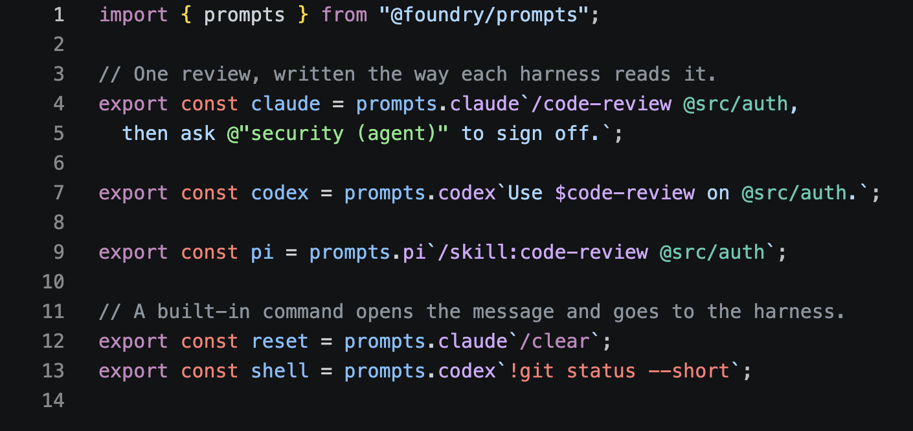
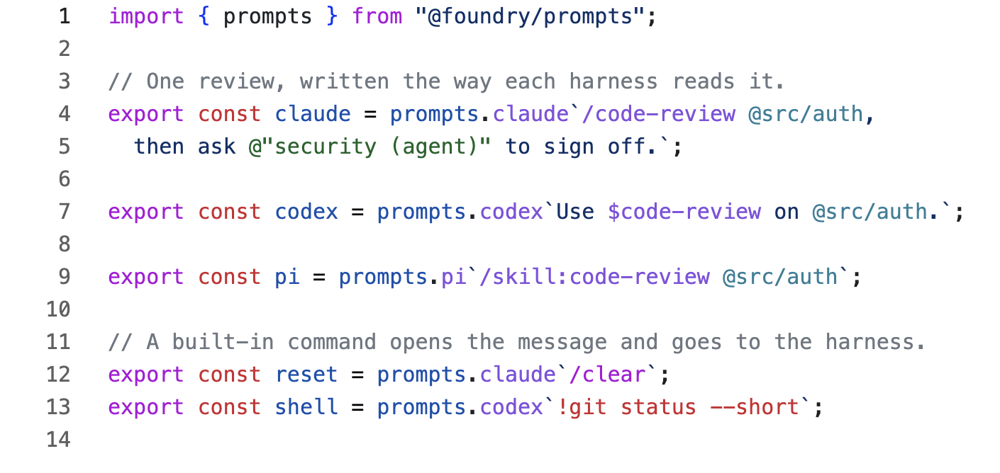
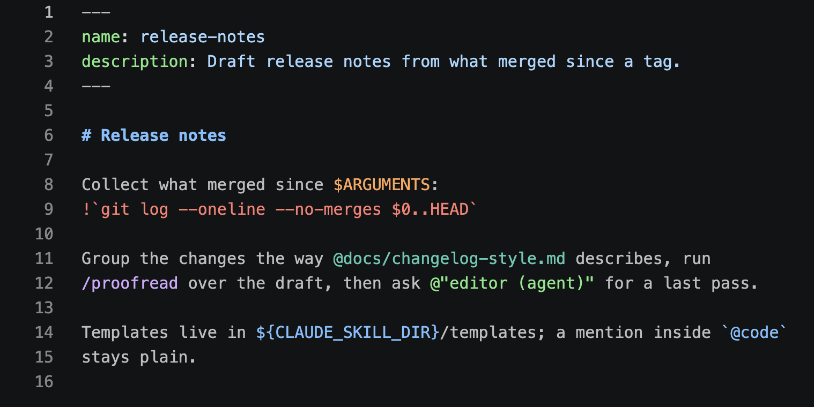
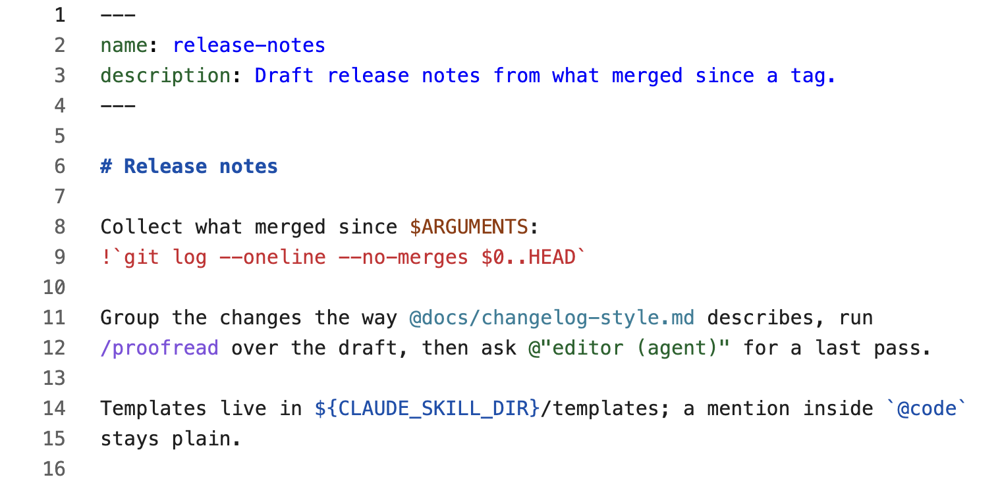
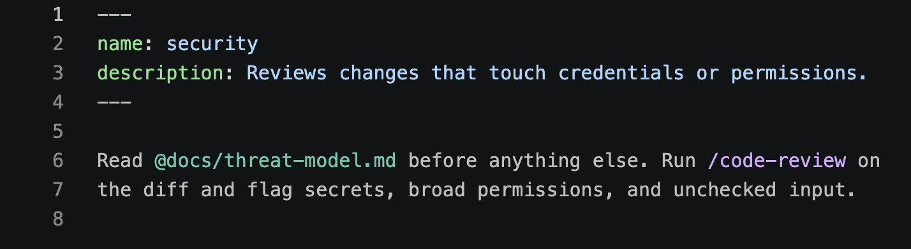
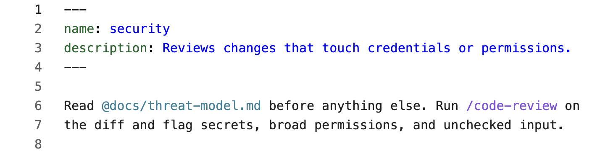

The Foundry Prompts extension for VS Code colours each thing a prompt
references: skills, agents, files, commands, templates, arguments, harness
variables, and shell. It reads each harness's own notation, so `/code-review`
in a Claude Code prompt, `$code-review` in a Codex prompt, and
`/skill:code-review` in a Pi prompt are all marked as the same skill. The
rest of the prompt stays a plain string.

<Tabs syncKey="theme">
  <Tab title="Dark">

<Frame caption="One review written for each harness, in the default **2026 Dark** theme.">



</Frame>

  </Tab>
  <Tab title="Light">

<Frame caption="The same file in **2026 Light**.">



</Frame>

  </Tab>
</Tabs>

## In TypeScript and JavaScript

The extension highlights prompts inside the `prompts` tags, as tagged
templates and as plain-string calls:

```typescript
prompts.claude`/code-review @src/auth`;
prompts.codex("use $review");
```

Any object can come before the dialect: `mine.claude` from `assemble`
highlights the same way as `prompts.claude`. A `${}` substitution inside a
prompt is still ordinary TypeScript, and a prompt written inside a
substitution is highlighted too. Other template literals, strings, and
comments are left alone.

In a template literal, notation that only works in a template is written with
backslash escapes: `` \${CLAUDE_SKILL_DIR} `` and `` !\`git status\` ``. The
extension highlights them as written.

## In skill, agent, and rule files

VS Code opens `SKILL.md`, `.claude/agents/*.md`, `.claude/rules/**/*.md`, and
`*.prompt.md` files with their own language ids. The extension reads the body
of each one as a Claude Code template, so arguments, `${CLAUDE_SKILL_DIR}`,
and inline shell are highlighted alongside skills, files, and agents.

<Tabs syncKey="theme">
  <Tab title="Dark">

<Frame caption="A skill. Frontmatter and code spans stay plain.">



</Frame>

  </Tab>
  <Tab title="Light">

<Frame caption="The same skill in **2026 Light**.">



</Frame>

  </Tab>
</Tabs>

Frontmatter, code spans, fenced code, and link targets stay plain. Ordinary
markdown, such as a README, is not highlighted at all.

<Tabs syncKey="theme">
  <Tab title="Dark">

<Frame caption="An agent definition in `.claude/agents/`.">



</Frame>

  </Tab>
  <Tab title="Light">

<Frame caption="The same agent in **2026 Light**.">



</Frame>

  </Tab>
</Tabs>

## What each harness reads

| Reference | Claude Code | Codex | Pi |
| --- | --- | --- | --- |
| Skill | `/code-review` | `$code-review` | `/skill:code-review`, opening the message |
| Built-in command | `/clear`, opening the message | `/review`, opening the message | `/compact`, opening the message |
| Prompt template | | `/prompts:draft`, opening the message | `/draft`, opening the message |
| File | `@src/auth` | `@src/auth` | `@src/auth` |
| Agent | `@"security (agent)"` | | |
| Argument | `$ARGUMENTS`, `$ARGUMENTS[0]`, `$0`, `$name` | `$ARGUMENTS`, `$1`, `$FILE` | `$1`, `$@` |
| Harness variable | `${CLAUDE_SKILL_DIR}` | | |
| Shell | `` !`git status` `` | `!git status`, as the whole message | `!git status`, as the whole message |

A command only counts when it opens the message. Later in the text,
`/review` is a skill in Claude Code and plain text in Codex. Codex escapes a
literal dollar sign as `$$`.

## Colours

The extension does not ship a theme. Each kind of reference gets a TextMate
scope that stock themes already colour, and the extension's tests check that
every kind stands out from the text around it in Dark+, Light+, and the
GitHub themes that VS Code's 2026 themes take their palette from.

| Kind | Scope |
| --- | --- |
| Skill, template | `entity.name.function.*.prompt` |
| Command | `keyword.control.command.prompt` |
| Agent | `entity.name.tag.agent.prompt` |
| File | `support.type.path.prompt` |
| Argument | `variable.parameter.argument.prompt` |
| Harness variable | `variable.other.constant.environment.prompt` |
| Shell | `keyword.other.shell.prompt` |

To restyle one kind, target its scope in `editor.tokenColorCustomizations`.
"Developer: Inspect Editor Tokens and Scopes" shows the scope under the
cursor.

## Install

The extension is not on a marketplace yet. Build and install it from a
Foundry checkout:

```sh
cd tooling/vscode-extension
bun run build            # writes dist/foundry-prompts.vsix
bun run editor:install   # installs it into VS Code, replacing any earlier copy
```

Reload open windows afterwards. To remove it, run
`code --uninstall-extension foundry.foundry-prompts`.

Other VS Code builds take the same file through their own CLI, such as
`cursor --install-extension dist/foundry-prompts.vsix --force`. An editor
built on an older VS Code may open skill files as plain markdown; there, only
the TypeScript half works.

## Limits

- **Highlighting only.** A skill or agent looks the same whether or not it
  exists. [Linting](/prompts/lint) checks them, through the ESLint or Oxc
  extension.
- **Custom dialect keys.** `mine.house` from `assemble` is not highlighted,
  because nothing in the source says which harness it is.
- **Command files.** VS Code opens `.claude/commands/*.md` as plain markdown,
  and highlighting there would colour every README.
- **One line at a time.** A grammar matches line by line, so in a few edge
  cases it reads a prompt differently from the parser. For example, a
  command on the line after the opening backtick is highlighted as a skill.
  The extension's README lists each case.

## Working on the extension

The extension lives in `tooling/vscode-extension`. Run the "Prompts extension"
launch configuration (F5) from the repository root to open a window with only
this extension loaded, on its sample files. `src/grammar.ts` builds the
grammars; after changing it, run `bun run grammar` and reload that window.

The tests run every grammar through a TextMate engine and compare what it
highlights with what the `@foundry/prompts` parser reads, for each harness.
