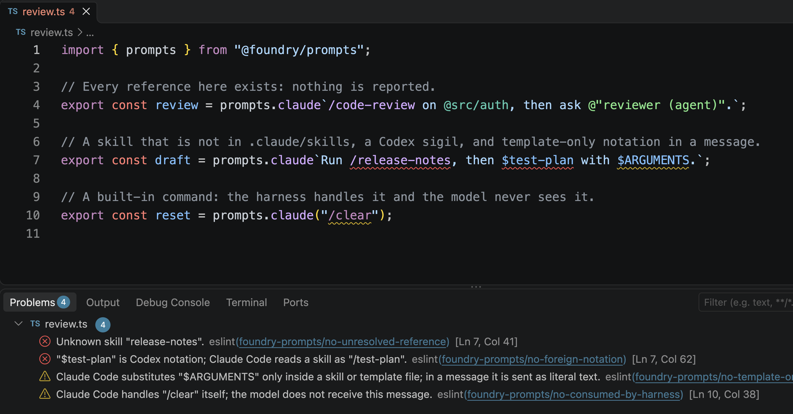
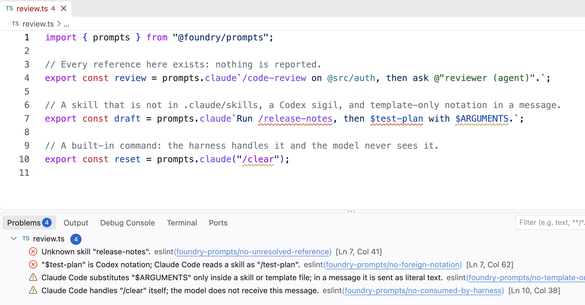

`@foundry/linting` checks prompts without running the code. The linter
parses the file and walks it; the rules pick out the prompts, hand their
text to `@foundry/prompts`, and report each finding where it was written.
One plugin loads in ESLint and in Oxlint, and a generated GritQL file does
the name-free half of the work in Biome. The editor extension for any of
them shows the findings inline.

The package is the home for every Foundry lint rule, grouped by domain.
Prompts are the first domain; its rules are `foundry/prompts/<code>`.

<Tabs syncKey="theme">
  <Tab title="Dark">

<Frame caption="ESLint's VS Code extension on Claude Code prompts, in **2026 Dark**: an unknown skill, a Codex sigil, `$ARGUMENTS` in a message, and a built-in command.">



</Frame>

  </Tab>
  <Tab title="Light">

<Frame caption="The same file in **2026 Light**.">



</Frame>

  </Tab>
</Tabs>

## What is checked

The rules read tagged templates and calls on a member named after a stock
dialect, on any object: `prompts.claude`, `mine.codex("…")`, `x.pi`. A call
counts when its only argument is a string literal or a template literal
with no substitutions. A `${}` inside a tagged template is a hole, and
nothing is ever reported across one: a reference built at runtime is
dynamic, not unknown.

| Rule | Reports | Biome |
| --- | --- | --- |
| `foundry/prompts/unresolved-reference` | A skill or agent that nothing listed has, and a command or variable the harness does not know. | |
| `foundry/prompts/foreign-notation` | A skill or agent you have, written the way another harness reads it: `$review` in a Claude Code prompt, where it should be `/review`. | |
| `foundry/prompts/template-only` | `$ARGUMENTS`, `${CLAUDE_SKILL_DIR}`, `` !`cmd` `` and the like in a message, where the harness sends them as literal text. | yes |
| `foundry/prompts/consumed-by-harness` | A message the harness acts on itself, such as `/clear` or `!git status`, so the model never receives it. | yes |

Each diagnostic code is its own rule, named after the code, so each has its
own severity. The two codes about interpolated values, `misread-reference`
and `unsupported-reference`, need the value and are left to the tag at
runtime.

The first two rules need to know what exists. Until you list skills or
agents, no skill or agent is questioned and no sigil is called foreign.
Commands and harness variables are checked against each dialect's
built-ins regardless, so `prompts.codex` opening with `/nope` is reported
with no configuration at all.

## Setup

The package is internal to Foundry for now, like `@foundry/prompts`. Point
it at your skills and agents; the settings under `settings.foundry.prompts`
are shared by every prompts rule.

```js
// eslint.config.js
import tsParser from "@typescript-eslint/parser";
import foundry from "@foundry/linting";

export default [
  {
    files: ["**/*.ts"],
    languageOptions: { parser: tsParser },
    ...foundry.configs.recommended,
    settings: {
      foundry: {
        prompts: {
          skills: [".claude/skills", "plugin:lint"],
          agents: [".claude/agents"],
        },
      },
    },
  },
];
```

```jsonc
// .oxlintrc.json
{
  "jsPlugins": ["@foundry/linting"],
  "rules": {
    "foundry/prompts/unresolved-reference": "error",
    "foundry/prompts/foreign-notation": "error",
    "foundry/prompts/template-only": "warn",
    "foundry/prompts/consumed-by-harness": "warn"
  },
  "settings": {
    "foundry": {
      "prompts": { "skills": [".claude/skills"], "agents": [".claude/agents"] }
    }
  }
}
```

| Setting | Meaning |
| --- | --- |
| `skills`, `agents` | Names, or directories to list. An entry with a slash or a leading dot is a directory. A skills directory contributes its subdirectory names, as in `.claude/skills/<name>/SKILL.md`; an agents directory contributes its `.md` file names. Paths are relative to the linter's working directory. |
| `dialects` | Extra member names and the stock dialect each reads as: `{ "house": "claude" }` checks `mine.house` from `assemble`. |
| `surface` | `message` by default. Set `template` for code that writes skill and command files, where `$ARGUMENTS` and inline shell belong. |

Nothing is discovered beyond what is listed. A directory is read with one
`readdir` and the listing is kept for two seconds, so a new skill shows up
in the editor without a read per prompt.

`configs.recommended` is an ESLint flat config object with every rule on,
errors as errors and warnings as warnings. Oxlint's JS plugins are alpha;
the plugin's tests run `oxlint` over the sample files to prove it loads.

## Biome

Biome's plugins are GritQL patterns, which cannot call `@foundry/prompts`.
So the package generates `biome/prompts-*.grit` from a regex mirror of the
notations, the way the editor grammar mirrors them, and tests that Biome
reports where ESLint reports.

```jsonc
// biome.jsonc
{
  "plugins": [
    "./node_modules/@foundry/linting/biome/prompts-consumed-by-harness.grit",
    "./node_modules/@foundry/linting/biome/prompts-template-only.grit"
  ]
}
```

Biome covers the two checks that need no list of names. It reads only the
stock member names, always as a message, and underlines the whole prompt
once rather than each reference, since a GritQL regex matches a node's
whole text. The rule name is at the end of the message; every plugin
finding is in Biome's `plugin` category, so suppress one with
`biome-ignore lint/plugin`. The other two rules wait for Biome to read
directories or run JavaScript.

## In the editor

The ESLint, Oxc, and Biome extensions for VS Code read the same config and
underline each finding, with the message in the Problems panel. Nothing in
[the Foundry Prompts extension](/prompts/editor) runs for this: it colours
references, and the linter checks them.

## Limits

- **References by value.** `${ref.skill("x")}` and a `defineSkill` value are
  holes to a static rule. The tag checks them at runtime; a type-aware check
  is a later step.
- **Skill and agent files.** `SKILL.md` and `.claude/agents/*.md` are not
  linted. Biome has no Markdown parser yet
  ([biome#3718](https://github.com/biomejs/biome/issues/3718)); the plan
  is to wait for it rather than lint Markdown through ESLint alone.
- **Biome checks two of the four.** Resolution and foreign notation need
  names, which a GritQL file cannot read. That changes if Biome ships JS
  plugins, at which point the ESLint rules port directly.
