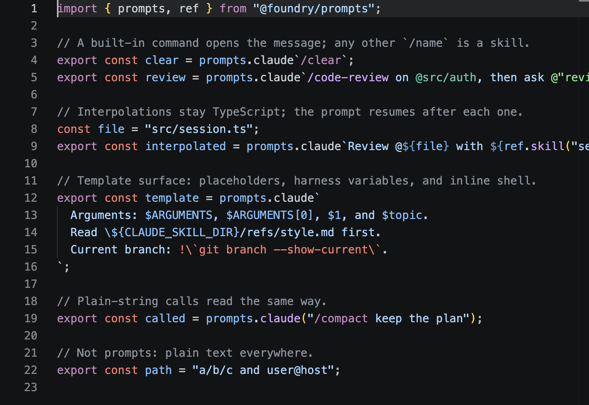
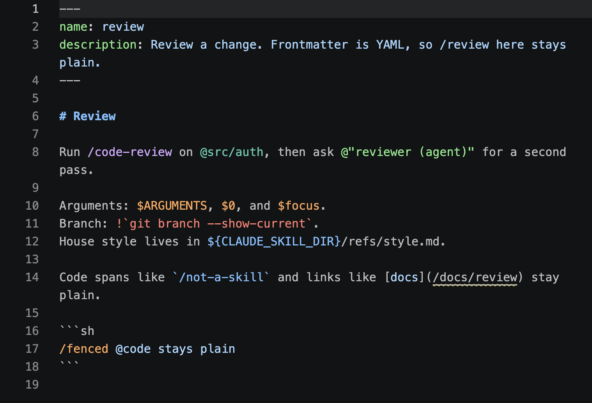

# Foundry Prompts for VS Code

Highlights what a prompt references: skills, agents, files, commands,
templates, arguments, harness variables, and shell. It works inside
`@foundry/prompts` tags and in Claude skill files. Each reference gets the
TextMate scope `HIGHLIGHT_SCOPES` assigns its token kind, so stock themes
colour it. The extension is grammars only for now: no extension code runs.

| Where | Read as |
| --- | --- |
| ``prompts.claude`…` ``, `x.claude("…")` | Claude Code |
| ``prompts.codex`…` ``, `x.codex("…")` | Codex |
| ``prompts.pi`…` ``, `x.pi("…")` | Pi |
| `SKILL.md`, `.claude/agents/*.md`, `.claude/rules/**/*.md`, `*.prompt.md` | Claude Code template |

Any qualifier works before the dialect member, so `mine.claude` from
`assemble` highlights too. The markdown files rely on the language ids VS
Code's built-in `prompt-basics` gives them. Plain markdown is left alone.





## Install

```sh
bun run build            # dist/foundry-prompts.vsix
bun run editor:install   # code --install-extension, replacing any earlier copy
```

For Cursor or another fork, install the same file with its own CLI, such as
`cursor --install-extension dist/foundry-prompts.vsix --force`. Reload open
windows afterwards. Uninstall with `code --uninstall-extension
foundry.foundry-prompts`.

## Develop

Run the "Prompts extension" launch configuration (F5) from the repository
root. It opens a window with only this extension loaded, on `fixtures/`.
After changing a grammar, run `bun run grammar` here, then "Developer:
Reload Window" in that window. "Developer: Inspect Editor Tokens and
Scopes" shows the scope under the cursor.

## Grammars

`src/grammar.ts` builds the grammars and `bun run grammar` writes them to
`syntaxes/`. Edit the module, never the JSON; a test fails when the two
differ. Notations in `@foundry/prompts` match with code, not regex, so
the grammar mirrors them by hand. The tests run each grammar through a
TextMate engine (Shiki's) and compare what it highlights with what
`Parser` reads. They also paint the references with Dark+, Light+ and
the GitHub themes VS Code's 2026 themes take their palette from, and fail
if any kind comes out the colour of the text around it.

The tests also record where the grammar and parser knowingly differ. A
grammar reads one line at a time, so:

- A command opens a message only on the backtick's own line.
- A sigil directly after `${…}` is not read as a reference.
- `\$ARGUMENTS` is not read as a placeholder.

## Not yet

- **Custom dialect keys** (`mine.house`): no grammar can know which dialect they are.
- **`.claude/commands/*.md`**: VS Code opens these as plain markdown, and an injection there would colour every README.
- **Resolution**: highlighting is the same whether or not a skill or agent exists. `tooling/linting` checks that through ESLint, Oxlint, or Biome, and their extensions show the findings.
- **Older editors**: before VS Code had `prompt-basics`, which includes Cursor's current base, skill files open as plain markdown and only the TypeScript half works.
